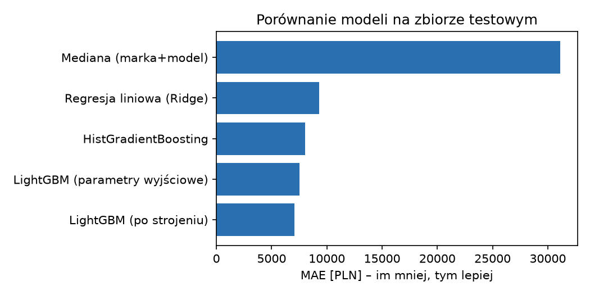
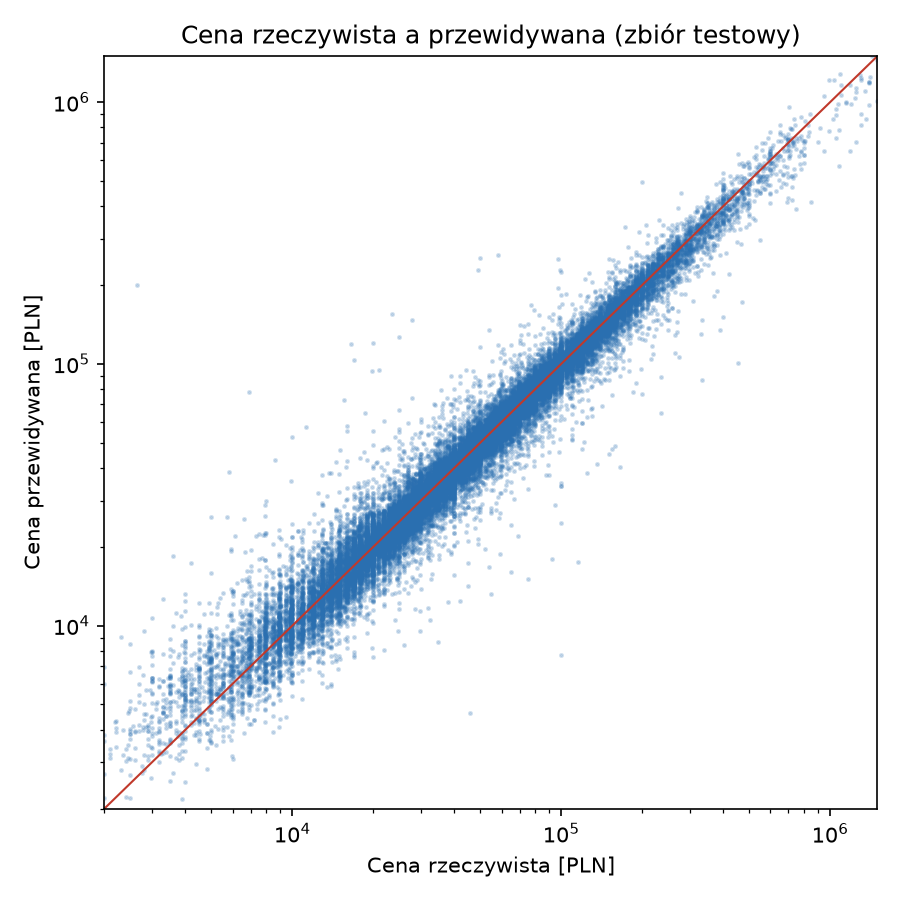
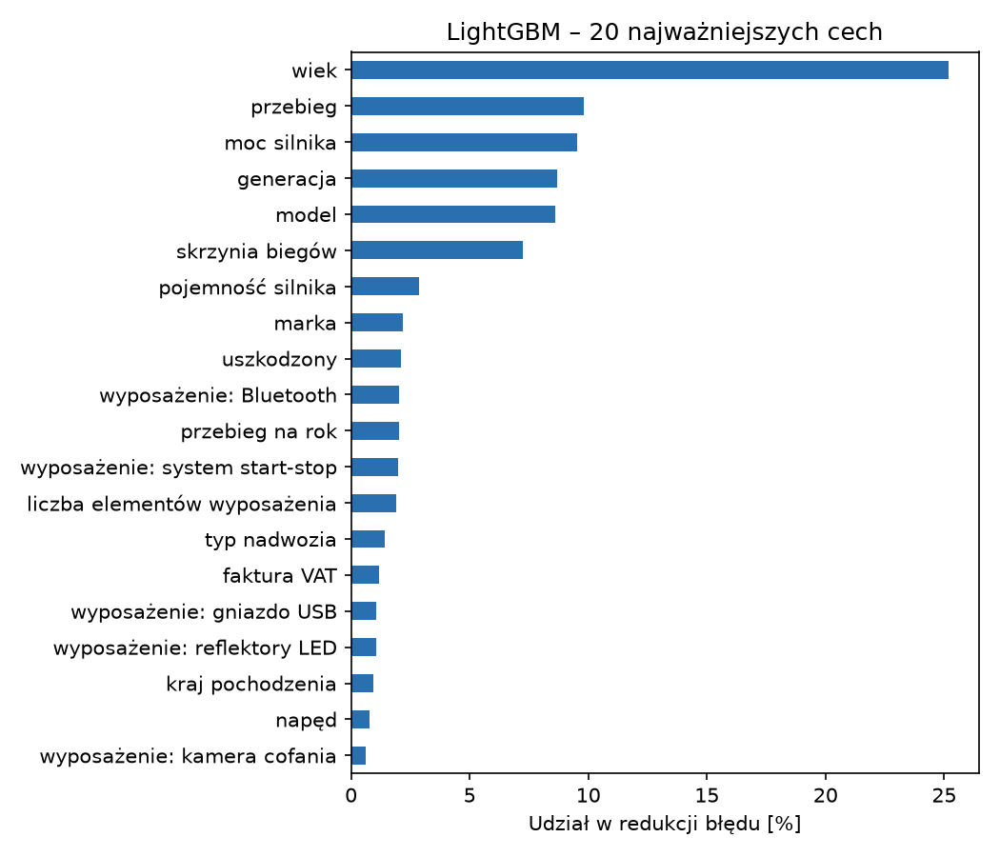

# Model wyceny samochodów używanych

Kod do pracy inżynierskiej „Opracowanie modelu wyceny samochodów używanych na potrzeby salonów samochodowych z wykorzystaniem uczenia maszynowego” (Politechnika Wrocławska, Wydział Zarządzania, Inżynieria zarządzania).

Model szacuje wartość rynkową (cenę ofertową) samochodu używanego na podstawie jego cech. Ma wspierać salon samochodowy przy wycenie aut przyjmowanych od klientów w rozliczeniu przy zakupie nowego samochodu.

## Struktura

| Plik | Zawartość |
|---|---|
| `model/mvp_model.py` | przygotowanie danych, uczenie i ocena modeli, wykresy, zapis modelu |
| `model/mvp_model.ipynb` | ten sam kod w postaci notatnika Jupyter, z wynikami poszczególnych kroków |
| `model/wycena_przyklad.py` | przykład wyceny pojedynczego samochodu za pomocą zapisanego modelu |
| `model/results/` | tabele miar błędu (CSV), wykresy i zapisane modele (`lightgbm_model.joblib` – model końcowy) |
| `model/requirements.txt` | wymagane biblioteki |
| `src/download_data.py` | pobranie zbioru danych z serwisu Kaggle |

## Dane

S. Cyperski, „Car sales offers from otomoto.pl 2023”, Kaggle, licencja CC BY-SA 4.0:
https://www.kaggle.com/datasets/szymoncyperski/car-sales-offers-from-otomotopl-2023

Plik `otomoto_offers_eng_23-04-2023.csv` (208 205 ofert, 243 kolumny) nie jest częścią repozytorium. Należy go umieścić w katalogu głównym repozytorium, np. za pomocą `python src/download_data.py`.

## Uruchomienie

```
pip install -r model/requirements.txt
python model/mvp_model.py
```

Pełne uruchomienie trwa około 12 minut. Wyniki zapisywane są w `model/results/`. Strojenie hiperparametrów (około 40 minut) jest domyślnie wyłączone, ponieważ wybrane wartości zapisano w kodzie; włącza je zmienna środowiskowa `RUN_TUNING=1`.

## Wyniki (zbiór testowy, 36 926 ofert)

| Model | MAE [PLN] | RMSE [PLN] | MAPE [%] | R² |
|---|---|---|---|---|
| Model naiwny (mediana dla marki i modelu) | 31 121 | 60 725 | 67,3 | 0,52 |
| Regresja liniowa Ridge | 9 282 | 24 064 | 15,1 | 0,93 |
| HistGradientBoosting | 8 040 | 20 777 | 13,2 | 0,94 |
| LightGBM, parametry wyjściowe | 7 500 | 18 409 | 12,7 | 0,96 |
| **LightGBM po strojeniu** | **7 090** | **17 889** | **12,3** | **0,96** |

W segmencie odpowiadającym zadaniu salonu (auta nieuszkodzone, nie starsze niż 15 lat; 76,5% ofert) MAPE modelu wynosi 9,3%.

### Porównanie modeli



### Cena rzeczywista a przewidywana

Każdy punkt to jedna oferta ze zbioru testowego (skala logarytmiczna); im bliżej czerwonej przekątnej, tym dokładniejsza wycena.



### Najważniejsze cechy

Udział cech w redukcji błędu modelu LightGBM. Najważniejsze są wiek, przebieg, moc silnika, generacja, model i rodzaj skrzyni biegów.



## Ograniczenia

- Model uczono na cenach ofertowych, a nie transakcyjnych; nie wyznacza on ceny odkupu.
- Informacje o stanie i historii pojazdu pochodzą z niezweryfikowanych deklaracji sprzedających.
- Dane pochodzą z jednego okresu (marzec–kwiecień 2023 r.); przed użyciem w praktyce model należy nauczyć ponownie na aktualnych ofertach.
